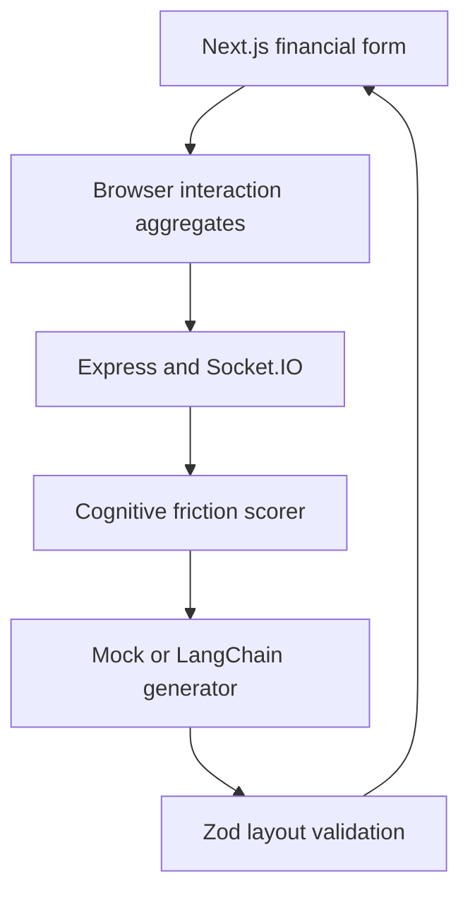

# Architecture and ownership

Requirements are provisional: the official assignment document has not yet been attached.

Only the form, API, mock generator, schema and Socket.IO readiness handshake exist on Day 1. Other nodes show the planned integration.

## Repository layout

- apps/web: Next.js, React, Tailwind and Motion
- apps/api: Express and Socket.IO
- packages/contracts: strict Zod layout specification, shared types and tests
- docs: architecture, API and progress
- .github/workflows: validation pipeline

## Day 1 assignments

| Owner | Responsibilities | Files |
| --- | --- | --- |
| Team leader | API foundation, mock mode, layout contract, tests, CI and architecture | apps/api, packages/contracts, .github, docs |
| Frontend teammate | Review initial form, field labels and styling; verify preservation and keyboard interaction; prepare telemetry hook design | apps/web |

The scaffold is prepared by the assistant for team review. It does not represent separate contributions authored by both members.

## Branch workflow

main is production; develop is integration. feature/ai-backend and feature/frontend-ui are development tracks. Use short-lived task branches and reviewed PRs into develop. Existing tamilarasan branch is preserved. Remote branch creation, pushing, merging and deployment require the user's approval. Never fabricate daily activity or backdate commits.

## Upcoming controls

Send only bounded interaction aggregates, not financial values, in telemetry. Validate all incoming events. Add cooldowns and deduplication before paid generation. Use structured output, limits and abortable requests. Preserve canonical form state and field identities during layout changes. Babel AST work will remain an isolated experiment; the primary app will never evaluate generated JavaScript.

Cognitive Friction Score is an interaction heuristic, not a clinical measurement. Precision and recall require labeled evaluation sessions. All numerical goals in the master prompt remain unmeasured targets.
